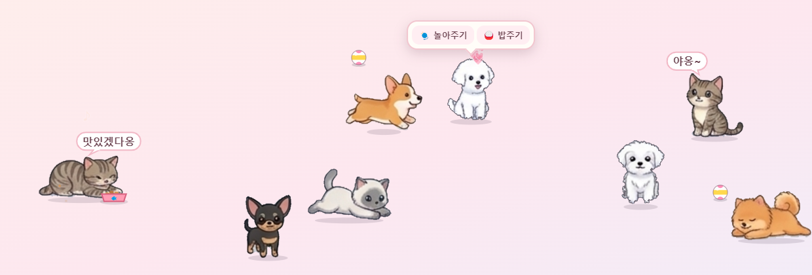

# 🐾 냥멍마실 (NyangMeongStroll)

모니터 위를 마실 다니는 귀여운 고양이와 강아지예요. ('마실'은 이웃에 놀러 다닌다는 우리말이에요.) Windows 바탕화면에서 다른 작업을 방해하지 않고, 작업 표시줄 위를 느긋하게 산책해요.

<!-- 스크린샷: docs/screenshot.png 를 넣고 아래 줄의 주석을 풀어 주세요 -->
<!--  -->

## 다운로드

[**Releases**](https://github.com/wowmylee/NyangMeongStroll/releases/latest)에서 `NyangMeongStroll.exe`를 받아 실행하세요. 설치할 필요가 없는 포터블 exe예요.

> 코드 서명이 없어서 "Windows의 PC 보호" 창이 뜰 수 있어요. **[추가 정보] → [실행]**을 누르면 실행돼요.
> 처음 실행할 때는 압축을 푸느라 몇 초 걸려요.

## 사용법

| 동작 | 방법 |
|---|---|
| 🧶 놀아주기 / 🍚 밥주기 | 동물에 마우스를 올리면 메뉴가 나와요 |
| 쓰다듬기 | 동물을 클릭하거나, 마우스를 올려두기 |
| 옮기기 | 동물을 드래그 |
| 설정 | 작업 표시줄 오른쪽 트레이의 고양이 아이콘 클릭 (안 보이면 `^` 안에 있어요) |
| 종료 | 트레이 아이콘 우클릭 → 종료 |

- 고양이 10종과 강아지 10종 중에서 최대 8마리까지 데려올 수 있어요.
- 동물들은 걷고, 앉고, 자고, 간식을 먹고, 가끔 혼자 공놀이도 해요.
- 설정에서 크기, 활동량, 돌아다닐 범위, 소리, 이름표, 언어(한국어/English)를 바꿀 수 있어요.
- **내 그림으로 동물 추가하기**에서 스프라이트 시트(한 줄에 한 종류, 단색 배경)를 넣으면 새 동물이 생겨요.

### 소리 바꾸기

exe와 같은 폴더에 `sounds` 폴더를 만들고 `cat1.wav`~`cat5.wav`, `dog1.wav`~`dog5.wav` 이름으로 넣으면, 앱에 들어 있는 소리 대신 그 파일이 나와요. wav, mp3, ogg, m4a 모두 돼요.

### 설정 저장 위치

`%APPDATA%\냥멍마실\settings.json`

## 직접 빌드하기

[Node.js](https://nodejs.org/) 18 이상이 필요해요.

```bash
npm install
npm start            # 개발 모드로 실행
npm run dist:win     # dist/NyangMeongStroll.exe (포터블) 생성
```

> Windows에서 빌드할 때 `Cannot create symbolic link` 오류가 나면, 관리자 권한 터미널에서 실행하거나 Windows **개발자 모드**를 켜 주세요.

## 프로젝트 구조

```
main.js          메인 프로세스 (창, 트레이, 설정 저장, 소리 파일 찾기)
preload.js       화면 ↔ 메인 프로세스 연결
renderer/
  overlay.*      바탕화면 위 동물 화면 (행동, 그리기, 마우스)
  settings.*     설정 창
  sprites.js     기본 동물 그림 좌표 정보
  cats.js        동물 그리기, 소품 (밥그릇, 간식, 캣타워)
  sounds.js      소리 재생
  slicer.js      내 그림 자동 자르기
  i18n.js        한국어 / English
assets/          동물 그림, 아이콘
sounds/          기본 소리 (cat1~5, dog1~5)
```

## 라이선스

**상업적 이용 금지 (Noncommercial only)** — 개인적인 사용, 공부, 비영리 목적으로는 자유롭게 쓰고 고칠 수 있지만, 판매하거나 유료 서비스·광고 수익 등 상업적으로 이용할 수 없어요.

| 대상 | 라이선스 |
|---|---|
| 소스 코드 | [PolyForm Noncommercial 1.0.0](LICENSE) |
| 그림 (`assets/`) | [CC BY-NC 4.0](https://creativecommons.org/licenses/by-nc/4.0/) — wowmylee 제작 (AI 이미지 생성 도구 사용) |
| 소리 (`sounds/`) | [CC BY-NC 3.0](https://creativecommons.org/licenses/by-nc/3.0/) — ESC-50 데이터셋 |

자세한 출처는 [CREDITS.md](CREDITS.md)를 봐 주세요. 상업적 이용 문의는 GitHub Issues로 남겨 주세요.
